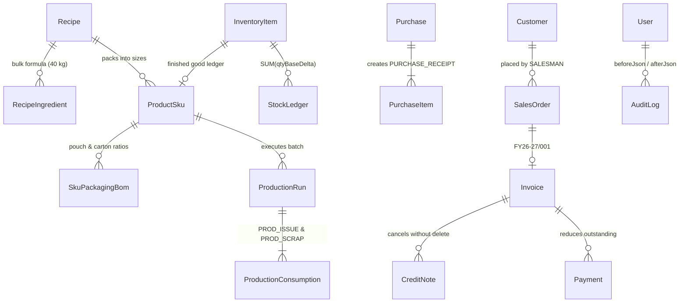

# SnackFlow — Architecture & Design Note

**System:** Order-to-Audit ERP for Packaged South Indian Snacks (`Kaveri Traditional Snacks Pvt Ltd`, Tamil Nadu `33`)

---

## 1. System & Data Model

Every transaction is entered once at its source and atomically updates `StockLedger`, `Invoice`/`CreditNote`, `Payment`, and `AuditLog` inside a single PostgreSQL ACID transaction.

---

## 2. Two-Layer BOM & Live Pack-Size Extensibility

Food manufacturing differs from discrete assembly: the same cooked batch of dough can be packed into multiple retail SKUs. SnackFlow separates the Bill of Materials into two layers:

1. **Layer 1 (`Recipe` & `RecipeIngredient`):** Defines the bulk dough formula in integer base units (`Murukku Base Batch`: `batchYieldG = 40,000 g` from `40,000 g` Flour, `10,000 ml` Cooking oil, and `1,200 g` Spice mix).
2. **Layer 2 (`ProductSku` & `SkuPackagingBom`):** Links each sellable pack SKU to its `Recipe` via `netWeightG` and defines packaging ratios as integer pairs (`qtyBase` per `perPackets` packets).
   - **Expected Packets Formula:** $\text{Expected Packets} = \lfloor \text{recipe.batchYieldG} / \text{sku.netWeightG} \rfloor \times \text{batchCount}$.
   - **Live Interview Extension (`Murukku 500 g`):** Adding a `500 g` pack size sharing `Murukku Base Batch` requires **zero schema or code changes**—only inserting a `ProductSku` (`netWeightG = 500`) and its `SkuPackagingBom` (`1` 500 g pouch per `1` packet; `1` carton per `10` packets). The engine automatically computes $40,000 / 500 = 80$ expected packets per batch and scales packaging and costing identically.

---

## 3. Immutable Ledger, Precision & Audit Trail

- **Double-Entry `StockLedger`:** Stock balances are never overwritten directly. Every movement (`INITIAL_OPENING`, `PURCHASE_RECEIPT`, `PROD_ISSUE`, `PROD_OUTPUT`, `PROD_SCRAP`, `SALES_DISPATCH`, `CREDIT_NOTE_RETURN`, `ADJUSTMENT`) appends a signed `qtyBaseDelta` and `totalValuePaisa` linked to `sourceType` and `sourceId`. For any item and date window:
  $$\text{Closing} = \text{Opening} + \text{Receipts} - (\text{Issues} + \text{Scrap}) - \text{Sales} + \text{Returns} \pm \text{Adjustments}$$
- **Zero-Drift Arithmetic:** Monetary totals (`taxablePaisa`, `cgstPaisa`, `sgstPaisa`, `igstPaisa`, `totalPaisa`, `paidPaisa`) are stored as **integer paisa** (`₹187.50 = 18750`) and manipulated via `BigInt` half-up division. Unit rates use **`Decimal(14, 4)`** (`₹43.1250/kg`). Physical quantities use integer base units (`GRAM`, `MILLILITRE`, `PIECE`) converted cleanly at display boundaries (`19,500 ml = 19.5 L`).
- **Immutability & Audit Trail:** Edits to orders, production run overheads, and invoice cancellations write `beforeJson` and `afterJson` snapshots with `userId` and timestamp to `AuditLog`. Posted invoices are never deleted—cancellation issues a sequential `CreditNote` (`CN/FY26-27/001`), reverses receivables, and records `CREDIT_NOTE_RETURN` if already dispatched.

---

## 4. Costing & Overhead Allocation Method

- **Valuation Method (Weighted Average Cost — WAC):** When a purchase is received, `StockLedger` records its pre-tax cost (`taxablePaisa`), and live WAC is derived from cumulative ledger value over cumulative base units:
  $$\text{Flour WAC} = \frac{100\,\text{kg} \times ₹42.00 + 60\,\text{kg} \times ₹45.00}{160\,\text{kg}} = \frac{₹6,900.00}{160\,\text{kg}} = ₹43.1250/\text{kg}$$
  WAC smooths commodity price fluctuations for bulk ingredients without requiring physical bin segregation of poured flour/oil. *(A FIFO comparison—`₹30.90/pkt` when consuming the `₹42/kg` opening flour batch—is also computed side-by-side.)*
- **Overhead & Scrap Allocation Rule:** Direct batch overheads (`labour` + `gas/power`) are logged per production run and divided evenly across `actualGoodPackets` produced. Normal pouch scrap (`6` damaged pouches = `₹15.00`) is absorbed into good output so packet cost reflects true saleable yield:

| Cost Component (Run `PRD-0001`, `188` Good Packets) | Quantity / Basis | WAC Cost |
| --- | --- | --- |
| Flour | `40 kg` @ `₹43.1250/kg` | `₹1,725.00` |
| Cooking oil | `10.5 L` @ `₹140.0000/L` (`+5%` flagged) | `₹1,470.00` |
| Salt and spice mix | `1.2 kg` @ `₹200.0000/kg` | `₹240.00` |
| 200 g pouches (good + scrap absorbed) | `188 + 6 = 194 pcs` @ `₹2.50` | `₹485.00` |
| Cartons | `9 pcs` @ `₹15.00` | `₹135.00` |
| Direct Labour + Gas/Power Overheads | `₹1,200.00 + ₹600.00` | `₹1,800.00` |
| **Total Batch Cost / Cost Per Good Packet** | `₹5,855.00 / 188 packets` | **`₹31.14 / packet`** |
| **Gross Margin vs. `₹50.00` Selling Price** | `₹50.00 − ₹31.14` (`(9400 − 5855) / 9400`) | **`₹18.86 / packet (37.71%)`** |
